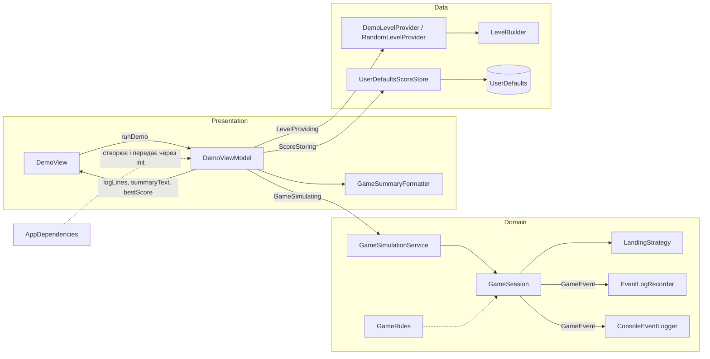

# Практична робота 2

Виконували вдвох: **Kolya Kulchytskyi** (архітектура, UI, доступ до даних, Builder, Adapter) і **Єгор Єсипович** (ігрова логіка, Strategy, Observer, `GameRules`, тести).

## Демо-сценарій

Той самий, що в ПР1, але тепер він проходить через компоненти MVVM. Кнопка «Запустити демо-сценарій» → `DemoViewModel` бере рівень у `LevelProviding`, запускає симуляцію через `GameSimulating`, зберігає рекорд у `ScoreStoring` і віддає View готові рядки журналу, підсумок і рекорд.

**Як перевірити:**
- запустити застосунок і натиснути «Запустити демо-сценарій». Очікувано: журнал і підсумок такі самі, як у ПР1 (рахунок 1291, 10 стрибків, 1 зламана платформа), з'являється «Рекорд: 1291» (при першому запуску — ще й «Новий рекорд!»), журнал дублюється в консоль Xcode. Після перезапуску рекорд зберігається;
- `./scripts/regression-check.sh` — запускає демо-сценарій поза Xcode і порівнює вивід з еталоном `scripts/baseline-demo-output.txt`. Очікувано: `OK: вивід демо-сценарію збігається з еталоном`;
- `xcodebuild test -scheme SkyJump -destination 'platform=iOS Simulator,name=iPhone 17'` — 7 тестів у `SkyJumpTests`;
- у Xcode Canvas для `DemoView` є два Preview: «Стаби» і «Справжня симуляція, тестовий рівень»;
- аргумент запуску `-randomLevel` (Edit Scheme → Run → Arguments) вмикає випадковий рівень замість демо.

## 1. Сценарії та ролі компонентів

| Сценарій | Представлення | Логіка | Доступ до даних |
|---|---|---|---|
| Запуск демо, показ журналу й підсумку | `DemoView`, `DemoViewModel`, `GameSummaryFormatter` | `GameSimulationService`, `GameSession`, `LandingStrategy`, `GameEvent` + спостерігачі | `DemoLevelProvider`, `LevelBuilder` |
| Поведінка платформ (пружина, ламка, рухома) | — | `LandingStrategies`, `BounceLanding`, `BreakLanding` | — |
| Рекорд гравця | рядок «Рекорд» у `DemoView` | `DemoViewModel.runDemo` | `UserDefaultsScoreStore`, `InMemoryScoreStore` |
| Випадковий рівень | — | — | `RandomLevelProvider`, `SeededRandomGenerator` |

## 2. Архітектура: MVVM

**Чому MVVM:** SwiftUI сам побудований на прив'язці стану до View, тож `@Observable` ViewModel — природний посередник. MVC у SwiftUI перетворюється на «товсту View»: саме так виглядав `ContentView` у ПР1, який сам створював сесію і рівень. VIPER (5 ролей на екран + роутер) надмірний для гри з одним екраном.



Напрямок залежностей: `Presentation → протоколи (Domain/Contracts) ← Data / Domain`. View знає лише ViewModel, ViewModel — лише протоколи, Domain не імпортує SwiftUI.

## 3. Структура проєкту

| Папка | Що там | Шар |
|---|---|---|
| `App/` | `SkyJumpApp`, `AppDependencies` (composition root: `live()`, `preview()`) | збирання застосунку |
| `Presentation/Demo/` | `DemoView`, `DemoViewModel`, `GameSummaryFormatter` | View, ViewModel |
| `Domain/Contracts/` | `LevelProviding`, `ScoreStoring`, `GameSimulating` + `GameReport`, `GameSummary` | контракти між шарами |
| `Domain/Models/` | `Player`, `Platform`, `PlatformType`, `GameObject`, `GameConfig`, `GameRules` | Model |
| `Domain/Game/` | `GameSession`, `GameSimulationService` | Model (логіка) |
| `Domain/Landing/` | `LandingStrategy` і реалізації | Model (логіка) |
| `Domain/Events/` | `GameEvent`, `GameEventObserver`, `EventLogRecorder`, `ConsoleEventLogger` | Model (логіка) |
| `Data/Levels/` | `LevelBuilder`, `DemoLevelProvider`, `RandomLevelProvider`, `SeededRandomGenerator` | Model (дані) |
| `Data/Storage/` | `UserDefaultsScoreStore`, `InMemoryScoreStore` | Model (дані) |
| `Preview/` | `StubLevelProvider`, `StubGameSimulator`, `AppDependencies.preview()` | тестові реалізації |
| `SkyJumpTests/` | тести `GameSession` і `DemoViewModel`, `SpyObserver` | тести |

**Потік сценарію «Запустити демо»:**
1. `SkyJumpApp` бере `AppDependencies.live()` і створює `DemoView` з `DemoViewModel`.
2. Кнопка → `DemoViewModel.runDemo()`.
3. `levelProvider.makeLevel()` → `DemoLevelProvider` будує рівень через `LevelBuilder`.
4. `simulator.simulate(...)` → `GameSimulationService` створює `GameSession` з `GameRules`, стратегіями і спостерігачами; сесія проганяє 8 секунд і надсилає події `EventLogRecorder` і `ConsoleEventLogger`.
5. Повертається `GameReport` (журнал + `GameSummary`); ViewModel форматує підсумок через `GameSummaryFormatter` і передає результат у `scoreStore.submit(score:)`.
6. View перемальовується за змінами `logLines`, `summaryText`, `bestScore`, `isNewRecord`.

## 4. Патерни

### 4.1 Builder (породжувальний) — `LevelBuilder`

- **Задача:** рівень складається з багатьох платформ. У ПР1 id призначалися вручну у двох місцях (`makeDemoLevel`, `makeRandomLevel`), а x не перевірявся на межі світу.
- **Учасники:** `LevelBuilder` — builder; `DemoLevelProvider`, `RandomLevelProvider`, `StubLevelProvider` — клієнти; продукт — `[Platform]`.
- **Де:** `Data/Levels/LevelBuilder.swift`, використовується в усіх провайдерах рівнів.

```swift
LevelBuilder()
    .platform(.normal, x: 160, y: 0)
    .platform(.breakable, x: 160, y: 360)
    .platform(.spring, x: 130, y: 450)
    .build()   // сортує за висотою, призначає id 0, 1, 2…, тримає x у межах світу
```

### 4.2 Adapter (структурний) — `UserDefaultsScoreStore`

- **Задача:** ViewModel потрібен простий інтерфейс рекорду, а `UserDefaults` має свій API (`integer(forKey:)`, `set(_:forKey:)`, ключі-рядки).
- **Учасники:** Target — `ScoreStoring`; Adaptee — `UserDefaults`; Adapter — `UserDefaultsScoreStore`; Client — `DemoViewModel`.
- **Де:** `Data/Storage/UserDefaultsScoreStore.swift`, підключається в `AppDependencies.live()`.

```swift
final class UserDefaultsScoreStore: ScoreStoring {
    init(defaults: UserDefaults, key: String = "bestScore")
    var bestScore: Int { defaults.integer(forKey: key) }
    func submit(score: Int) -> Bool   // зберігає, лише якщо це новий рекорд
}
```

### 4.3 Strategy (поведінковий) — `LandingStrategy`

- **Задача:** поведінка при приземленні була розкидана між `switch` у `PlatformType.jumpVelocity` та `if let … else` у `GameSession.handleLanding`. Новий тип платформи вимагав правок у двох місцях.
- **Учасники:** Strategy — `LandingStrategy`; конкретні стратегії — `BounceLanding(velocity:)` (звичайна, рухома, пружина) і `BreakLanding`; Context — `GameSession`.
- **Де:** `Domain/Landing/LandingStrategy.swift`; набір за замовчуванням — `LandingStrategies.standard(rules:)`, інший набір передається через `GameSession.init` / `GameSimulationService.init`.

```swift
let strategy = landingStrategies[platform.type] ?? BounceLanding(velocity: rules.jumpVelocity)
switch strategy.land(player: player, on: &platforms[index]) {
case .jumped: emit(.jumped(platformID: platform.id, type: platform.type, height: platform.position.y))
case .broke:  brokenPlatformsCount += 1; emit(.platformBroken(platformID: platform.id))
}
```

### 4.4 Observer (поведінковий) — `GameEventObserver`

- **Задача:** у ПР1 `GameSession` сам вів журнал (`log`, `addLog`), а View друкувала його в консоль — це не їхня відповідальність.
- **Учасники:** Subject — `GameSession` (`addObserver`, `emit`); Observer — `GameEventObserver`; подія — `GameEvent`; конкретні спостерігачі — `EventLogRecorder` (журнал для екрана) і `ConsoleEventLogger` (консоль Xcode).
- **Де:** `Domain/Events/`; `GameSimulationService` завжди підписує `EventLogRecorder`, а `AppDependencies.live()` додає `ConsoleEventLogger`. Сесія тримає спостерігачів слабкими посиланнями.

```swift
protocol GameEventObserver: AnyObject {
    func gameSession(didEmit event: GameEvent, at time: Double)
}
```

## 5. SOLID

| Принцип | Як виконано в проєкті |
|---|---|
| **S** — єдина відповідальність | `DemoView` лише показує стан, `DemoViewModel` керує сценарієм, `GameSession` лише симулює кадри. Журнал винесено в `EventLogRecorder`, текст подій — у `GameEvent.message`, підсумок — у `GameSummaryFormatter`, поведінку платформ — у стратегії, побудову рівня — у `LevelBuilder`, збереження рекорду — у сховище. |
| **O** — відкритість/закритість | Новий тип платформи = нова `LandingStrategy` і запис у словнику; `GameSession` не змінюється (тест `customLandingStrategyIsUsedWithoutChangingSession`). Новий обробник подій — новий `GameEventObserver` без змін у сесії. Нове джерело рівня — новий `LevelProviding`. |
| **L** — підстановка Лісков | Клієнти працюють з будь-якою реалізацією лише через контракт: `InMemoryScoreStore` ↔ `UserDefaultsScoreStore`, `DemoLevelProvider` ↔ `RandomLevelProvider` ↔ `StubLevelProvider`, `GameSimulationService` ↔ `StubGameSimulator`, стандартні стратегії ↔ `CountingBreakLanding`, спостерігачі ↔ `SpyObserver`. |
| **I** — розділення інтерфейсів | Замість одного великого «GameService» — малі протоколи з одним-двома членами: `LevelProviding`, `ScoreStoring`, `GameSimulating`, `LandingStrategy`, `GameEventObserver`. `DemoViewModel` не знає про `GameSession`, стратегії й події. |
| **D** — інверсія залежностей | `DemoViewModel` залежить від протоколів, `GameSession` — від `LandingStrategy` і `GameEventObserver`; конкретні реалізації і `GameRules` передаються через `init`. Обирає їх лише composition root `AppDependencies`. |

**Як замінити реалізацію без зміни компонента:**
- `AppDependencies.preview()` підставляє `StubLevelProvider`, `StubGameSimulator` і `InMemoryScoreStore` — `DemoViewModel` і `DemoView` при цьому не змінювались (коміт `b0af610`);
- у тестах `DemoViewModel` працює з `TestLevelProvider` і `InMemoryScoreStore`, а `GameSession` — зі `SpyObserver`, `CountingBreakLanding` та іншими `GameRules`;
- у реальному запуску рівень змінюється аргументом `-randomLevel` — лише в `AppDependencies.live()`.

## 6. Антипатерни

| # | Було (ПР1) | Де | Як виправлено |
|---|---|---|---|
| 1 | Пряме поєднання UI з логікою і даними: View сама створювала `GameSession` і `LevelFactory`, робила `print` | `ContentView` | `DemoView` → `DemoViewModel` → протоколи; реалізації створює `AppDependencies` |
| 2 | Приховані глобальні залежності: `Double.random`, статичний `LevelFactory` | `LevelFactory` | генератор передається в `RandomLevelProvider` через init, `UserDefaults` — у `UserDefaultsScoreStore`; `LevelFactory` видалено |
| 3 | Надмірна відповідальність: симуляція + журнал + форматування підсумку + поведінка платформ | `GameSession` | Observer, `GameSummaryFormatter`, Strategy |
| 4 | Дублювання: `switch` у `PlatformType.jumpVelocity` + `if let` у `handleLanding`; призначення id у двох фабричних методах | `PlatformType`, `GameSession`, `LevelFactory` | одне місце — `LandingStrategies.standard`; id — лише в `LevelBuilder` |
| 5 | Глобальні константи фізики (`gravity`, `jumpVelocity`, `springMultiplier`, `screenHeight`) | `GameConfig` | `GameRules` з `.standard`, передається через init у сервіс → сесію → `Player` і стратегії |

У `GameConfig` лишились лише розміри світу й об'єктів (`worldWidth`, ширини, швидкості руху) — незмінні геометричні параметри, а не прихований змінний стан.

## 7. Відповідність «патерн / принцип — компонент — призначення»

| Патерн / принцип | Компонент | Призначення |
|---|---|---|
| MVVM | `DemoView`, `DemoViewModel`, Domain / Data | розділення представлення, логіки й даних |
| Composition root / DI | `AppDependencies` (`live()`, `preview()`) | створення залежностей і передача через init |
| Builder (породжувальний) | `LevelBuilder` ← `DemoLevelProvider`, `RandomLevelProvider`, `StubLevelProvider` | покрокова побудова рівня, id і межі в одному місці |
| Adapter (структурний) | `UserDefaultsScoreStore` : `ScoreStoring` | `UserDefaults` під інтерфейс сховища рекорду |
| Strategy (поведінковий) | `LandingStrategy`, `BounceLanding`, `BreakLanding` ← `GameSession` | поведінка платформи при приземленні |
| Observer (поведінковий) | `GameSession` → `EventLogRecorder`, `ConsoleEventLogger` | журнал і консоль без логування всередині сесії |
| S | `GameSession`, `GameSummaryFormatter`, `EventLogRecorder`, `LevelBuilder` | кожен компонент має одну причину для змін |
| O | `LandingStrategies`, `GameEventObserver` | нова поведінка без зміни `GameSession` |
| L | реалізації `LevelProviding`, `ScoreStoring`, `GameSimulating`, `LandingStrategy` | взаємозамінні реалізації за одним контрактом |
| I | `Domain/Contracts`, `LandingStrategy`, `GameEventObserver` | малі протоколи під конкретного клієнта |
| D | `DemoViewModel`, `GameSession`, `GameSimulationService` | залежність від абстракцій, реалізації через init |

## 8. Коміти й теги

- Архітектурний каркас (окремий коміт): тег [`lab2-skeleton`](https://github.com/YehorYesypovych/SkyJumpIOS/tree/lab2-skeleton), коміт [`739a5af`](https://github.com/YehorYesypovych/SkyJumpIOS/commit/739a5af).
- Частина 1 (Kolya): [PR #1](https://github.com/YehorYesypovych/SkyJumpIOS/pull/1). Частина 2 (Єгор): [PR #2](https://github.com/YehorYesypovych/SkyJumpIOS/pull/2).
- Фінальний стан роботи: тег [`lab2`](https://github.com/YehorYesypovych/SkyJumpIOS/tree/lab2).
