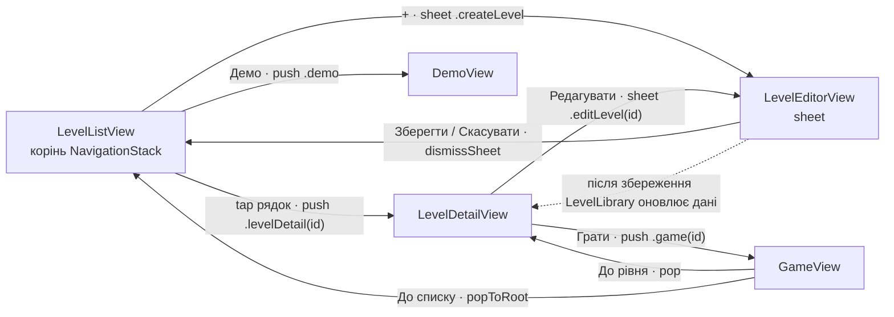

# Практична робота 3

Інтерфейс, навігація та анімації. Виконували вдвох: **Kolya Kulchytskyi** (частина A) і **Єгор Єсипович** (частина B).

## 1. Сценарій і як його пройти

Нова функція — **«Мої рівні»**: бібліотека рівнів-пресетів. Рівень можна створити, відредагувати, переглянути й зіграти; рекорд зберігається для кожного рівня окремо. Дані на цьому етапі — у пам'яті (`LevelLibrary`), стартовий набір — три демо-рівні.

**Екрани:**

| Екран | Тип переходу | Призначення |
|---|---|---|
| `LevelListView` — «Мої рівні» | корінь стеку | список рівнів, створення, видалення, перехід до демо |
| `LevelDetailView` — деталі рівня | push | дані рівня, склад платформ, «Грати», «Редагувати» |
| `LevelEditorView` — редактор | модальне вікно (sheet) | створення і редагування рівня |
| `GameView` — гра | push | симуляція рівня, рахунок, рекорд, журнал |
| `DemoView` — демо-сценарій з ПР1/ПР2 | push | попередній демо-сценарій без змін у логіці |

**Як пройти сценарій:**
1. Запустити застосунок → відкривається «Мої рівні» з рівнями «Розминка», «Класика», «Хардкор».
2. «+» → модальний редактор → ввести назву, кількість платформ, складність → «Зберегти». Новий рівень з'являється в кінці списку.
3. Тапнути рівень → деталі. «Редагувати» → той самий редактор з даними рівня → змінити назву → «Зберегти». Деталі й список одразу показують нову назву.
4. «Грати» → екран гри: «Симуляція…», потім рахунок і (при першій грі) бейдж «Новий рекорд!».
5. «До рівня» → деталі показують рекорд і кількість ігор. Повторна гра того самого рівня дає той самий рахунок (рівень детермінований за seed), тому нового рекорду немає, а кількість ігор зростає.
6. «До списку» з екрана гри → повернення в корінь; у рядку рівня видно рекорд і кількість ігор.
7. Свайп по рядку списку → видалення рівня. Кнопка «Демо» в тулбарі → старий демо-сценарій.

## 2. Карта навігації

Між екранами передається **ідентифікатор** рівня (`LevelPreset.ID`), а не його копія. Кожен екран бере актуальний рівень з `LevelLibrary` — тому зміни після редагування чи гри видно на всіх екранах без додаткового «повернення результату».

## 3. Router: відповідальність, стан, цикли посилань

**Компоненти навігації** (`SkyJump/App/Navigation/`, `Domain/Contracts/AppNavigating.swift`):

| Компонент | Відповідальність |
|---|---|
| `Route`, `Sheet` | перелік екранів: стекові маршрути і модальні вікна з параметрами (id рівня) |
| `AppNavigating` | протокол команд навігації, від якого залежать ViewModel: `showLevel`, `startGame`, `showDemo`, `pop`, `popToRoot`, `presentCreateLevel`, `presentEditLevel`, `dismissSheet` |
| `AppRouter` | `@Observable` реалізація: зберігає стан навігації — `path: [Route]` (стек) і `sheet: Sheet?` (модальне вікно) |
| `RootView` | прив'язує `NavigationStack(path:)` і `.sheet(item:)` до стану роутера |
| `ScreenFactory` | створює екран і його ViewModel з потрібними залежностями для кожного маршруту |

**Як це працює:** ViewModel викликає, наприклад, `navigator?.startGame(id)` → роутер додає `.game(id)` у `path` → SwiftUI бачить зміну стану й показує екран, який для цього маршруту створює `ScreenFactory`. Кнопка «Назад» і свайп змінюють `path` через прив'язку, тож стан роутера завжди відповідає тому, що на екрані.

**Чому так:**
- ViewModel не знає про SwiftUI-навігацію і не створює інших екранів — лише просить роутер. Тому їх легко тестувати: у тестах замість роутера `SpyNavigator`, який записує виклики.
- Уся карта переходів в одному місці (`Route`, `Sheet`, `ScreenFactory`), а не розкидана `NavigationLink`-ами по екранах.
- Стан навігації — звичайні значення, тож його можна перевірити тестами (`AppRouterTests`).

**Цикли сильних посилань.** Цикл виникає, коли два об'єкти тримають один одного сильними посиланнями: наприклад, роутер зберігав би ViewModel екранів, а ViewModel — роутер. Тоді після закриття екрана жоден з них не звільнився б. У проєкті:
- роутер зберігає лише значення (`Route`, `Sheet`), а не екрани чи ViewModel;
- ViewModel тримають навігатор **слабким** посиланням (`weak var navigator: AppNavigating?`), а сам роутер живе у `SkyJumpApp` (`@State`);
- `GameSession` з ПР2 так само тримає спостерігачів слабкими посиланнями.

## 4. Передавання даних і повернення результату редагування
<!-- Частина B -->

## 5. Анімації

### 5.1 Поява нового рекорду на екрані гри

Анімація пов'язана зі станом результату гри (`GameView`):
- поки гра не запущена, показується «Симуляція…»; через 0,35 с `viewModel.start()` викликається всередині `withAnimation(.spring(duration: 0.5, bounce: 0.35))`;
- рахунок змінюється з 0 до результату з `.contentTransition(.numericText())` — цифри «прокручуються»;
- бейдж «Новий рекорд!» з'являється лише коли `isNewRecord == true`, з переходом `.scale(scale: 0.4).combined(with: .opacity)` — «вистрибує» з пружиною;
- підсумок виїжджає знизу (`.move(edge: .bottom)` + `.opacity`), журнал подій розгортається кнопкою зі шевроном, що обертається.

**Чому анімація не заважає взаємодії:** стан змінюється одразу, анімується лише його відображення; анімації короткі (≤ 0,5 с); кнопки «До рівня» і «До списку» доступні весь час, у тому числі під час анімації (жодного `allowsHitTesting(false)`); запуск прив'язаний до `.task`, тож при поверненні назад до завершення паузи задача скасовується. З увімкненим **Reduce Motion** (`accessibilityReduceMotion`) бейдж з'являється лише через прозорість, без масштабування, а журнал — без анімації.

### 5.2 Розгортання складу рівня і валідація в редакторі
<!-- Частина B -->

## 6. Перевірка інтерфейсу
<!-- Частина B: два розміри екрана, клавіатура, повторні переходи -->

## 7. Скриншоти і відео
<!-- Частина B: файли в docs/screenshots/ -->

## 8. Хто що робив
<!-- Частина A, у фіналі -->
