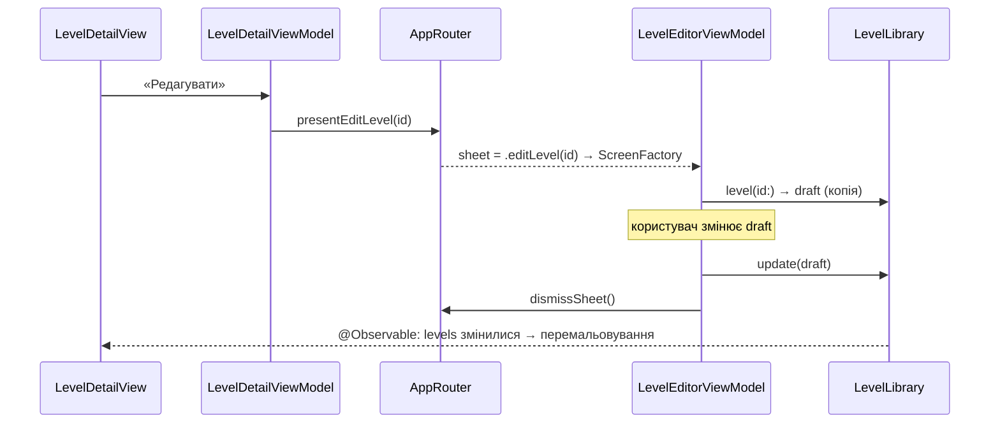

# Практична робота 3

Інтерфейс, навігація та анімації. Виконували вдвох: **Kolya Kulchytskyi** (частина A) і **Єгор Єсипович** (частина B).

## 1. Сценарій і як його пройти
<!-- Частина A -->

## 2. Карта навігації
<!-- Частина A -->

## 3. Router: відповідальність, стан, цикли посилань
<!-- Частина A -->

## 4. Передавання даних і повернення результату редагування
<!-- Частина B -->

**Вперед передається лише ідентифікатор.** Маршрути `Route.levelDetail(id)`, `Route.game(id)` і `Sheet.editLevel(id)` несуть `LevelPreset.ID`, а не копію рівня. `ScreenFactory` створює ViewModel з цим id і спільною `LevelLibrary`.

**Деталі читають рівень з бібліотеки щоразу.** `LevelDetailViewModel.level` — обчислювана властивість `library.level(id: levelID)`, копії рівня у ViewModel немає. `LevelLibrary` — `@Observable`, тому коли View читає `viewModel.level`, SwiftUI підписується на `library.levels` і перемальовує екран після будь-якої зміни: редагування, нового рекорду, видалення (тоді `level == nil` і показується `ContentUnavailableView`).

**Редактор працює з чернеткою.** `LevelEditorViewModel.draft` — копія `LevelPreset` (struct, семантика значення):
- `.create` → `LevelPreset.makeNew()`; `.edit(id)` → копія рівня з бібліотеки;
- форма змінює лише `draft`, бібліотека до збереження не змінюється (це перевіряє тест `saveInEditModeUpdatesExistingLevel`);
- «Зберегти» → `library.add(draft)` або `library.update(draft)`, потім `navigator.dismissSheet()`;
- «Скасувати» → лише `dismissSheet()`, відкочувати нічого не треба (тест `cancelDoesNotChangeLibrary`).

**Повернення результату.** Редактор не повертає значення екрану, який його відкрив, і не викликає жодних колбеків. Результат «повертається» через спільне джерело правди: після `library.update` і список, і деталі, які вже лежать у стеку під модальним вікном, читають оновлений рівень і перемальовуються самі. Так немає ні дублювання стану, ні замикань між екранами.

**Стекова vs модальна навігація.** Push (`path.append`) — наступний крок ієрархії: список → деталі → гра, «Назад» повертає по стеку. Sheet — окрема задача поверх поточного контексту (створення/редагування), яка завершується явно «Зберегти» або «Скасувати». Тому редактор має власний `NavigationStack` (для заголовка і тулбара), а не додається у спільний `path`.

## 5. Анімації

### 5.1 Поява нового рекорду на екрані гри
<!-- Частина A -->

### 5.2 Розгортання складу рівня і валідація в редакторі
<!-- Частина B -->

**Склад рівня (деталі).** Секція «Склад рівня» показує, скільки платформ кожного типу згенерує пресет (`platformStats` рахується з `PresetLevelProvider`, тож збігається з грою).
- Тап по заголовку → `withAnimation(.snappy) { viewModel.toggleStats() }`. Стан `isStatsExpanded` змінюється одразу, анімується лише відображення.
- Рядки з'являються з `.transition(.move(edge: .top).combined(with: .opacity))`, шеврон повертається на 90° через `.rotationEffect`.
- З увімкненим Reduce Motion (`@Environment(\.accessibilityReduceMotion)`) — без анімації переходу, рядки лише з'являються (`.opacity`).

**Валідація (редактор).** Повідомлення (`validationMessage`) показується у футері секції «Назва»:
- порожня або з самих пробілів назва, назва довша за 30 символів, кількість платформ поза 5…50;
- поява/зміна повідомлення анімована: `.animation(.snappy, value: validationMessage)` + `.transition(.move(edge: .top).combined(with: .opacity))`;
- кнопка «Зберегти» вимкнена, поки `!canSave`.

Анімації короткі (`.snappy` ≈ 0,3 с), не використовують `allowsHitTesting(false)` і не блокують тапи: секцію можна згорнути/розгорнути кілька разів поспіль під час анімації.

## 6. Перевірка інтерфейсу
<!-- Частина B: два розміри екрана, клавіатура, повторні переходи -->

Перевіряли в симуляторі Xcode 27 (iOS 27): найменший доступний iPhone — **iPhone 17e** (390×844 pt), базовий **iPhone 17** (402×874 pt) і найбільший **iPhone 18 Pro Max** (440×956 pt). iPhone SE і 16e у Xcode 27 доступні лише з iOS 17.5, а застосунок вимагає iOS 17.6+, тому найменшим став 17e.

| Що перевірено | Пристрій | Результат |
|---|---|---|
| Список → «+» → ввести назву, змінити складність → «Зберегти»: рівень з'являється в списку | iPhone 17, iPhone 17e | ✅ |
| Список → деталі (push) → «Склад рівня» розгортається/згортається, шеврон повертається, кількість платформ за типами = `platformCount` | iPhone 17, iPhone 17e | ✅ |
| Деталі → «Редагувати» (sheet) з даними рівня → змінити → «Зберегти»: деталі й список одразу показують нові дані | iPhone 17, iPhone 17e | ✅ |
| Порожня назва: повідомлення «Введіть назву рівня» з'являється анімовано, «Зберегти» вимкнена | iPhone 17, iPhone 17e | ✅ |
| Клавіатура відкрита: «Скасувати» і «Зберегти» в тулбарі лишаються видимими й натискаються; збереження без закриття клавіатури | iPhone 17, iPhone 17e | ✅ |
| Режим створення: поле назви отримує фокус автоматично, клавіатура відкривається одразу | iPhone 17, iPhone 17e | ✅ |
| Є незбережені зміни → свайп униз не закриває редактор (`interactiveDismissDisabled`) | iPhone 17e | ✅ |
| «Скасувати» без змін закриває sheet, дані не змінюються | iPhone 17 | ✅ |
| Деталі → «Грати» (push) → «Назад»: деталі зберігають стан (розгорнутий склад рівня) | iPhone 17, iPhone 17e | ✅ |
| Кілька переходів поспіль за одну сесію (≈10: список ↔ деталі ↔ редактор ↔ гра, два різні рівні) без втрати даних | iPhone 17, iPhone 17e | ✅ |
| Великий шрифт (Accessibility Large, `simctl ui content_size`): рядки переносяться на два рядки, нічого не перекривається; у редакторі кнопки тулбару доступні | iPhone 17 | ✅ |
| Альбомна орієнтація: форма редактора й деталі вміщуються, тулбар доступний | iPhone 17 | ✅ |
| Список рівнів на великому екрані | iPhone 18 Pro Max | ✅ |
| Тапи під час анімації розгортання: кожен тап змінює стан, анімація не блокує взаємодію | iPhone 17 | ✅ |

**Знайдено й виправлено під час перевірки:**
- на iPhone 17e inline-заголовок редактора між «Скасувати» і «Зберегти» обрізався («Новий риве…», `iphone17e-00-editor-title-before-fix.png`) → заголовок зроблено великим (`.navigationBarTitleDisplayMode(.large)`), він показується під тулбаром повністю;
- назви типів платформ у складі рівня через `.capitalized` писалися «З Пружиною» → з великої літери лише перше слово.

Скриншоти `iphone17-*.png` зроблено до цих двох виправлень, `iphone17e-*.png` — після.

## 7. Скриншоти і відео
<!-- Частина B: файли в docs/screenshots/ -->

Файли в [`docs/screenshots/`](screenshots/):

| Екран | iPhone 17e (малий) | iPhone 17 | iPhone 18 Pro Max (великий) |
|---|---|---|---|
| Список рівнів | `iphone17e-01-list.png` | `iphone17-01-list.png` | `iphone18promax-01-list.png` |
| Редактор: створення | `iphone17e-02-editor-create.png` | `iphone17-08-editor-create.png` | — |
| Редактор: клавіатура, «Зберегти» видно | `iphone17e-03-editor-keyboard.png` | `iphone17-05-editor-keyboard.png` | — |
| Редактор: валідація | — | `iphone17-06-editor-validation.png` | — |
| Деталі | `iphone17e-04-detail.png` | `iphone17-02-detail.png` | — |
| Деталі: склад рівня розгорнуто | `iphone17e-05-detail-expanded.png` | `iphone17-03-detail-expanded.png` | — |
| Редактор: редагування | `iphone17e-06-editor-edit.png` | `iphone17-04-editor-edit.png` | — |
| Деталі після редагування | `iphone17e-07-detail-after-edit.png` | `iphone17-07-detail-after-edit.png` | — |
| Великий шрифт | — | `iphone17-09-detail-large-text.png`, `iphone17-10-editor-large-text.png` | — |
| Альбомна орієнтація | — | `iphone17-11-editor-landscape.png` | — |

**Відео** `scenario.mov` (iPhone 17e, прискорено ×10, ≈1 хв 50 с): список → «+» → створення рівня «Небо» → деталі → розгортання складу → «Редагувати» → спроба закрити свайпом зі змінами → «Зберегти» → деталі оновлені → «Грати» → «Назад» → список. Записано `xcrun simctl io booted recordVideo`.

## 8. Хто що робив
<!-- Частина A, у фіналі -->
