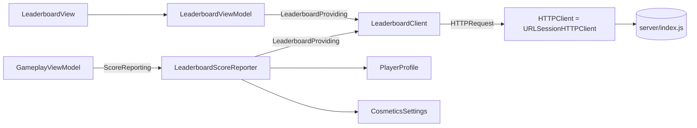

# Практична робота 4

Взаємодія із сервером та обробка даних. Виконували вдвох: **Kolya Kulchytskyi** (частина A) і **Єгор Єсипович** (частина B).

## 1. Джерела даних

### 1.1 Radio Browser (відкрите API)
Відкритий каталог інтернет-радіо [radio-browser.info](https://www.radio-browser.info). Використовується на екрані «Радіо» — станції synthwave, retrowave, vaporwave, 80s, chillwave.

| | |
|---|---|
| Базова адреса | `https://de1.api.radio-browser.info`, запасні — `de2`, `fi1` (дзеркала одного каталогу) |
| Endpoint | `GET /json/stations/bytag/{tag}` |
| Параметри | `hidebroken=true` — без зламаних станцій; `order=clickcount&reverse=true` — найпопулярніші першими; `limit=25` |
| Авторизація | не потрібна; каталог просить представлятися, тому надсилається `User-Agent: SkyJump/1.0` |
| Формат | JSON-масив станцій |

Приклад запиту:

```
GET https://de1.api.radio-browser.info/json/stations/bytag/synthwave?hidebroken=true&order=clickcount&reverse=true&limit=25
```

Приклад відповіді (скорочено, лише поля, які читає застосунок):

```json
[
  {
    "stationuuid": "9617a958-0601-11e8-ae97-52543be04c81",
    "name": "Nightride FM",
    "url": "https://stream.nightride.fm/nightride.m4a",
    "url_resolved": "https://stream.nightride.fm/nightride.m4a",
    "country": "Canada", "countrycode": "CA",
    "tags": "synthwave,retrowave,80s",
    "favicon": "https://nightride.fm/favicon.png",
    "codec": "AAC", "bitrate": 128,
    "lastcheckok": 1, "clickcount": 812
  }
]
```

Відповідь декодується в `RadioBrowserStationDTO` (`Data/Radio/RadioBrowserClient.swift`): `url_resolved` перейменовано через `CodingKeys`, необов'язкові поля — `Optional`. Далі `RadioStationMapper` залишає лише те, що справді можна відтворити: лише `https`, кодеки MP3 / AAC / AAC+ / HLS, остання перевірка каталогу пройдена, без дублів за назвою.

### 1.2 SkyJump Leaderboard (власний сервер)

Глобальна таблиця лідерів нескінченного режиму. Сервер — [`server/index.js`](../server/index.js): Node.js 18+, лише вбудовані модулі (`http`, `fs`, `crypto`), `npm install` не потрібен. Докладна інструкція й приклади `curl` — [`server/README.md`](../server/README.md).

```bash
node server/index.js
```

- **Базова адреса:** `http://localhost:8080` (`ServerConfig.baseURL`). Симулятор на тому ж Mac звертається до неї без налаштувань. Для iPhone: Edit Scheme → Run → Arguments → `-serverURL http://<IP Mac>:8080`; сервер слухає всі інтерфейси (`0.0.0.0`).
- **Авторизація:** немає (навчальний сервер, секретів у репозиторії немає).
- **Зберігання:** `server/data/scores.json` (створюється сам, у `.gitignore`), запис атомарний — через тимчасовий файл.

| Метод | Шлях | Параметри / тіло | Відповідь |
|---|---|---|---|
| `GET` | `/health` | — | `200 {"status":"ok"}` |
| `GET` | `/api/leaderboard` | `limit` 1…100 (20), `simulate` | `200 {"entries":[…]}` за спаданням рахунку; `400` — неправильний `limit` |
| `POST` | `/api/scores` | `Content-Type: application/json`, тіло `{"player","score","theme"}` | `201 {"entry":{…},"rank":N}`; `400 {"error":"…"}` |

Запис таблиці (`LeaderboardEntry`):

```json
{ "id": "a79adada-…", "player": "Єгор", "score": 1200, "theme": "neonBeach", "createdAt": "2026-11-24T20:28:06Z" }
```

`createdAt` — ISO 8601 (UTC), `theme` — `WorldTheme.rawValue`. При рівному рахунку вище той, хто набрав його раніше; `rank` — місце нового запису, з 1.

Перевірка тіла `POST`: `player` — 1…20 символів (пробіли по краях обрізаються), `score` — ціле ≥ 0, `theme` — непорожній рядок до 32 символів. Інакше `400` з поясненням; некоректний JSON → `400`; невідомий шлях → `404`, невідомий метод → `405`.

**Режими перевірки** `simulate` (лише `GET /api/leaderboard`): `empty` — `200 {"entries":[]}`; `error` — `500`; `broken` — `200` з обірваним JSON; `slow` — звичайна відповідь через 3 с. У застосунку їх вмикає аргумент запуску `-leaderboardSimulate <режим>` — запит тоді йде на справжній сервер з `?simulate=…`.

## 2. Мережевий шар
Мережа винесена в окремий компонент, екрани й ViewModel з `URLSession` не працюють.

```
RadioView ── RadioViewModel ── RadioStationProviding ── RadioBrowserClient ── [HTTPClient] ── URLSession
                                (протокол)                (Data/Radio)          (протокол)
```

| Тип | Файл | Роль |
|---|---|---|
| `HTTPClient` | `Domain/Contracts/HTTPClient.swift` | протокол: `send(_:as:) async throws -> T` для будь-якої `Decodable`-моделі |
| `HTTPRequest`, `HTTPMethod` | там само | метод, шлях, параметри, заголовки, тіло — без прив'язки до URLSession |
| `NetworkError` | там само | `transport(URLError.Code)`, `httpStatus(Int)`, `decoding(String)`, `invalidResponse` |
| `URLSessionHTTPClient` | `Data/Network/URLSessionHTTPClient.swift` | реалізація на `URLSession`: базова адреса, заголовки за замовчуванням, таймаут, декодер |
| `NetworkError.userMessage` | `Presentation/Common/NetworkError+Message.swift` | текст помилки для користувача |
| `LoadState<Value>` | `Presentation/Common/LoadState.swift` | стан екрана: `idle`, `loading`, `loaded`, `empty`, `failed` |

**Порядок обробки відповіді** в `URLSessionHTTPClient.data(for:)`:

1. Запит не відбувся (`URLError`: немає інтернету, таймаут, хост недоступний) → `NetworkError.transport(code)`.
2. Відповідь не HTTP → `.invalidResponse`.
3. Статус не `2xx` → `.httpStatus(code)`. **Тіло такої відповіді не декодується як успішні дані**: сторінка помилки чи JSON з кодом 404 не перетвориться на «порожній список».
4. Лише після цього — `JSONDecoder`. `DecodingError` → `.decoding(опис)`, де опис каже, якого поля не вистачило або який тип не збігся (`URLSessionHTTPClient.describe`).

Скасування запиту (`URLError.cancelled`, `CancellationError`) помилкою для користувача не вважається — екран просто закрили.

**Перебір дзеркал Radio Browser.** `RadioBrowserClient` отримує через `init` масив `[any HTTPClient]` — по одному на сервер. Якщо сервер недоступний (`transport`, `invalidResponse`) або відповів `5xx`, пробується наступний. Помилка формату чи `4xx` іншим сервером не виправиться, тому віддається одразу (`RadioBrowserClient.shouldTryNextServer`). Жанр, що не завантажився, не ламає весь список: помилка — лише якщо не вдався жоден запит.

**Передавання залежностей.** Конкретні реалізації обираються лише в composition root:

```swift
// AppDependencies.live()
radioProvider: RadioBrowserClient(clients: RadioBrowserClient.liveClients()),
```

`ScreenFactory` передає `dependencies.radioProvider` у `RadioViewModel(provider:player:)`. У Preview і тестах замість мережі — `StubRadioProvider`, `StubStationsProvider` або `ScriptedHTTPClient`; код ViewModel при цьому не змінюється.

## 3. Стани екранів і помилки

### 3.1 Радіо

`RadioViewModel.state: LoadState<[RadioStation]>` — єдине джерело стану екрана.

| Стан | Коли | Що бачить користувач |
|---|---|---|
| `.idle` / `.loading` | перше відкриття, повтор після помилки | «Шукаємо хвилі…» з індикатором; повзунок гучності, жанри й кнопка «Назад» доступні |
| `.loaded(stations)` | каталог повернув станції | список станцій, фільтр за жанром, міні-плеєр |
| `.empty` | каталог відповів, але придатних станцій немає | «Ефір порожній» і кнопка «Оновити» |
| `.failed(message)` | помилка мережі, сервера чи формату | «Радіо мовчить», текст причини і кнопка «Спробувати ще раз» |

Порожня відповідь — **не помилка**: `RadioBrowserClient.stations(for:)` повертає `[]`, а ViewModel переводить екран у `.empty`.

Під час «потягни, щоб оновити» вже показаний список лишається на екрані, поки йде запит. Повторне натискання під час завантаження ігнорується; якщо стартував новий запит (наприклад, у режимі перевірки), відповідь попереднього відкидається.

Тексти помилок (`NetworkError.userMessage`) різні для різних причин, технічні подробиці (назва поля JSON) не показуються:

| Помилка | Текст |
|---|---|
| `transport(.notConnectedToInternet)` | Немає інтернету. Перевір з'єднання і спробуй ще раз. |
| `transport(.timedOut)` | Сервер довго не відповідає. Спробуй ще раз. |
| `transport(.cannotConnectToHost)` | Сервер недоступний. Спробуй трохи згодом. |
| `httpStatus(5xx)` | Помилка на сервері (код 500). Спробуй трохи згодом. |
| `httpStatus(4xx)` | Сервер відхилив запит (код 404). |
| `decoding`, `invalidResponse` | Сервер надіслав неочікувану відповідь. Спробуй трохи згодом. |

### 3.2 Лідери



- **`LeaderboardClient`** (`Data/Leaderboard/`) — лише збирає `HTTPRequest` (`GET /api/leaderboard?limit=`, `POST /api/scores` з JSON-тілом і `Content-Type: application/json`) і віддає його `HTTPClient`. Відповідь декодується прямо в моделі домену (`LeaderboardEntry`, `SubmitResult`); для списку є лише обгортка `LeaderboardResponse` (`{"entries":[…]}`). Усі вони `nonisolated` і `Sendable`, бо мережевий компонент декодує поза головним потоком, а типова ізоляція проєкту — `MainActor`.
- **`LeaderboardViewModel`** — стан `LoadState<[LeaderboardEntry]>`:

| Стан | Коли | Що бачить гравець |
|---|---|---|
| `.loading` | запит іде | індикатор «Завантажуємо таблицю…»; поле ніка й «Назад» працюють |
| `.loaded(entries)` | є записи | місця (🥇🥈🥉, далі номер), нік, емодзі теми, «2 хвилини тому», рахунок; свій рядок підсвічено й позначено «ти» |
| `.empty` | `{"entries":[]}` | «Ще ніхто не грав» — це не помилка |
| `.failed(message)` | будь-яка `NetworkError` | «Таблиця недоступна» + пояснення + «Спробувати ще раз» |

Стани показуються всередині списку, а не поверх нього, тому поле ніка лишається доступним за будь-якого стану. «Потягни, щоб оновити» не прибирає вже показану таблицю, поки йде запит. Скасування (`CancellationError`, `URLError.cancelled`) не вважається помилкою — повертається попередній стан.

**Тексти помилок** — спільні для обох екранів, з `NetworkError.userMessage` (частина A). Екран «Лідери» додає лише одне: коли до сервера не вдалося під'єднатися, підказує, що його треба запустити.

| `NetworkError` | Повідомлення |
|---|---|
| `.transport(.notConnectedToInternet)` | Немає інтернету. Перевір з'єднання і спробуй ще раз. |
| `.transport(.timedOut)` | Сервер довго не відповідає. Спробуй ще раз. |
| `.transport(.cannotConnectToHost)` | Сервер таблиці лідерів недоступний. Перевір, що він запущений (node server/index.js). |
| `.httpStatus(500)` | Помилка на сервері (код 500). Спробуй трохи згодом. |
| `.decoding`, `.invalidResponse` | Сервер надіслав неочікувану відповідь. Спробуй трохи згодом. |

- **Нік** — `PlayerProfile` (`@Observable`, `UserDefaults`): за замовчуванням «Doodler», 1…20 символів після обрізання пробілів. Змінюється в полі на екрані «Лідери» (кнопка «Зберегти» або Return), неправильний нік не зберігається й пояснюється під полем.
- **Надсилання рахунку** — `LeaderboardScoreReporter: ScoreReporting`. `GameplayViewModel` викликає `report(score:)` лише після кінця нескінченної гри; reporter бере нік із профілю й тему з `CosmeticsSettings` і надсилає в окремому `Task` — гра не чекає мережі. Рахунок 0 (гра без жодного стрибка) не надсилається. Результат (`надсилаємо…` / `N місце` / `не надіслано: причина`) показується карткою на екрані «Лідери», а щойно надісланий запис підсвічується навіть після зміни ніка.
- **Режим перевірки** (лише Debug, кнопка 🐞): «Справжній сервер», «Приклад даних», «Порожня таблиця», «Немає мережі», «HTTP 500», «Пошкоджений JSON», «Повільна відповідь». Підміняє джерело на `StubLeaderboard` і одразу перезавантажує — так само, як режим перевірки радіо.

## 4. Як перевірити

### 4.1 Радіо

**Справжній API.** Запустити застосунок, у тулбарі списку рівнів відкрити «Радіо». З'являється «Шукаємо хвилі…», потім список станцій. Тап по станції вмикає її; «потягни вниз» оновлює список.

**Контрольовані стани.** У Debug-збірці в тулбарі екрана «Радіо» є меню режиму перевірки (іконка жучка). Пункт перемикає джерело на `StubRadioProvider` з потрібним сценарієм і одразу перезавантажує екран; над повзунком гучності з'являється підпис «Перевірка: …».

| Пункт меню | Очікуваний результат |
|---|---|
| Справжній API | реальний запит до Radio Browser, список станцій |
| Тестові станції | три тестові станції без мережі |
| Порожня відповідь | «Ефір порожній» + «Оновити» |
| Немає мережі | «Радіо мовчить» — «Немає інтернету…» + «Спробувати ще раз» |
| HTTP 500 | «Помилка на сервері (код 500)…» |
| Пошкоджений JSON | справжнє декодування зіпсованої станції → «Сервер надіслав неочікувану відповідь…» |
| Повільна відповідь | 3 секунди індикатора, під час яких можна піти назад чи змінити гучність, потім список |

**Справжня відсутність мережі.** Вимкнути Wi-Fi на Mac (або Network Link Conditioner → 100% Loss), відкрити «Радіо» вперше після запуску — «Немає інтернету…»; увімкнути мережу і натиснути «Спробувати ще раз» — список.

### 4.2 Лідери

Скриншоти — iPhone 18 Pro Max, `docs/screenshots/lab4-leaderboard-*.png`.

| Крок | Очікувано | Перевірено | Скриншот |
|---|---|---|---|
| `node server/index.js`, у застосунку 🏆 | таблиця з сервера, свій нік підсвічено «ти», дати «N хвилин тому» | ✅ | `lab4-leaderboard-data.png` |
| Зупинити сервер, відкрити «Лідери» | «Сервер таблиці лідерів недоступний… (node server/index.js)» + «Спробувати ще раз» | ✅ | `lab4-leaderboard-server-down.png` |
| Запустити сервер, «Спробувати ще раз» | знову таблиця | ✅ | — |
| Аргумент `-leaderboardSimulate broken` | у лозі сервера `GET /api/leaderboard?limit=20&simulate=broken`, на екрані «Сервер надіслав неочікувану відповідь» | ✅ | — |
| 🐞 → «Порожня таблиця» | «Ще ніхто не грав» | ✅ | `lab4-leaderboard-empty.png` |
| 🐞 → «Повільна відповідь» | ~3 с індикатор «Завантажуємо таблицю…», поле ніка й «Назад» доступні | ✅ | `lab4-leaderboard-loading.png` |
| 🐞 → «HTTP 500» | «Помилка на сервері (код 500)» | ✅ | `lab4-leaderboard-http500.png` |
| 🐞 → «Пошкоджений JSON» | «Сервер надіслав неочікувану відповідь» | ✅ | `lab4-leaderboard-broken-json.png` |
| Меню режиму перевірки | 7 сценаріїв, поточний позначено ✓ | ✅ | `lab4-leaderboard-debug-menu.png` |
| `curl` усіх ендпоінтів і `simulate` (див. `server/README.md`) | коди 200/201/400/404/405/500, порожньо, обірваний JSON, затримка 3 с | ✅ | — |

Надсилання рахунку після справжньої нескінченної гри в симуляторі вручну не проходили (для цього треба грати до падіння). Його покривають тести: reporter надсилає нік і тему й запам'ятовує місце, а `GameplayViewModel` викликає reporter рівно один раз після кінця нескінченної гри.

## 5. Тести

Запуск: ⌘U у Xcode.

**Мережевий клієнт** — `SkyJumpTests/URLSessionHTTPClientTests.swift`. Справжній `URLSessionHTTPClient`, але `URLSession` налаштована на `StubURLProtocol`: відповідь задає тест, у мережу запит не йде.

| Тест | Що перевіряє |
|---|---|
| `validJSONIsDecoded` | 200 + коректний JSON → модель |
| `serverErrorIsReportedBeforeDecoding` | 500 з HTML-тілом → `.httpStatus(500)`, а не помилка декодування |
| `clientErrorStatusIsReported` | 404 з коректним JSON не вважається успіхом |
| `invalidJSONIsDecodingError` | 200 + JSON не тієї форми → `.decoding` з описом |
| `noInternetIsTransportError` | `URLError(.notConnectedToInternet)` → `.transport` |
| `requestReachesNetworkWithPathQueryAndHeaders` | шлях дописується до базового, параметри, `User-Agent`, `Accept`, власні заголовки |
| `postRequestCarriesBody` | метод POST і тіло запиту |
| `NetworkErrorMessageTests` | різні причини — різні тексти, без технічних подробиць |

**Радіо** — `SkyJumpTests/RadioTests.swift`.

| Набір | Що перевіряє |
|---|---|
| `RadioStationMapperTests` | відбір станцій, поля, зібраний запит до каталогу |
| `RadioBrowserClientTests` | перехід на наступне дзеркало при недоступності і `5xx`; помилка формату не повторюється; усі сервери недоступні → помилка; порожня відповідь → `[]` |
| `RadioViewModelTests` | дані, порожньо, помилка з кодом, повтор після помилки, усі сценарії режиму перевірки, фільтр за жанром |

**Таблиця лідерів** — `SkyJumpTests/LeaderboardTests.swift`. Мережі в тестах немає: `LeaderboardClient` отримує `RecordingHTTPClient` (запам'ятовує `HTTPRequest` і декодує заготовлений JSON тим самим декодером `.skyJump`), ViewModel і reporter — `ScriptedLeaderboard` із заготовленими відповідями.

| Набір | Що перевіряє |
|---|---|
| `LeaderboardClientTests` | декодування `{"entries":[…]}` і `SubmitResult` з датою ISO 8601; невідповідний JSON → `.decoding`; GET із `limit` (і обмеження 1…100, `simulate`); POST з `Content-Type` і JSON-тілом `player/score/theme`; HTTP 500 прокидається як `.httpStatus(500)` |
| `LeaderboardViewModelTests` | дані → `.loaded`; порожньо → `.empty`, не помилка; чотири види помилок дають чотири різні тексти; повтор після помилки показує дані; `loadIfNeeded` не перезавантажує; свій рядок; неправильний нік не зберігається |
| `ScoreReporterTests` | нік валідується й зберігається в `UserDefaults`; reporter надсилає нік і тему, запам'ятовує місце; 0 не надсилається; помилка надсилання показується; нескінченна гра викликає reporter рівно один раз після падіння (рівневий режим не викликає — `ScoreReportingTests` з каркаса) |

Сервер перевірено `curl`-запитами з `server/README.md` (усі коди відповіді й режими `simulate`).

## 6. Хто що робив
| Учасник | Що робив |
|---|---|
| Kolya Kulchytskyi | Каркас ПР4: мережеве ядро (`HTTPClient`, `HTTPRequest`, `NetworkError`, `URLSessionHTTPClient`, `ServerConfig`), стан екрана `LoadState`, контракти таблиці лідерів; радіо через мережевий компонент з перебором дзеркал Radio Browser; стани екрана радіо і тексти помилок `NetworkError.userMessage`; режим перевірки станів радіо; тести мережевого клієнта на `URLProtocol`-заглушці і тести радіо; розділи 1.1, 2, 3.1, 4.1 і 5 (радіо) документації |
| Єгор Єсипович | Власний сервер таблиці лідерів на Node.js (`server/`): топ, надсилання рахунку, валідація, режими `simulate`; клієнт `LeaderboardClient` на мережевому компоненті; нік гравця `PlayerProfile` і надсилання рахунку після нескінченної гри; екран «Лідери» зі станами і режимом перевірки; тести таблиці лідерів; скриншоти станів; розділи 1.2, 3.2, 4.2 і 5 (лідери) документації |

Спільно: контракти між частинами (`LeaderboardProviding`, `ScoreReporting`, формат API сервера) погоджено заздалегідь у плані, кожна частина — окрема гілка і PR (#5, #6), конфліктів під час злиття не було.
