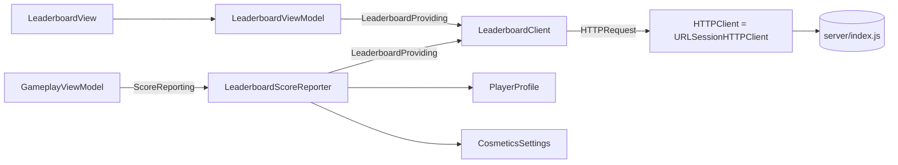

# Практична робота 4

Взаємодія із сервером та обробка даних. Виконували вдвох: **Kolya Kulchytskyi** (частина A) і **Єгор Єсипович** (частина B).

## 1. Джерела даних

### 1.1 Radio Browser (відкрите API)
<!-- Частина A: базова адреса, endpoint, параметри, формат відповіді, авторизація -->

### 1.2 SkyJump Leaderboard (власний сервер)
<!-- Частина B: запуск сервера, endpoints, формат, simulate -->

Глобальна таблиця лідерів нескінченного режиму. Сервер — [`server/index.js`](../server/index.js): Node.js 18+, лише вбудовані модулі (`http`, `fs`, `crypto`), `npm install` не потрібен. Докладна інструкція й приклади `curl` — [`server/README.md`](../server/README.md).

```bash
node server/index.js
```

- **Базова адреса:** `http://localhost:8080` (`ServerConfig.baseURL`). Симулятор на тому ж Mac звертається до неї без налаштувань. Для iPhone: Edit Scheme → Run → Arguments → `-serverURL http://<IP Mac>:8080`; сервер слухає всі інтерфейси (`0.0.0.0`).
- **Авторизація:** немає (навчальний сервер, секретів у репозиторії немає).
- **Зберігання:** `server/data/scores.json` (створюється сам, у `.gitignore`), запис атомарний — через тимчасовий файл.

| Метод | Шлях | Параметри / тіло | Відповідь |
|---|---|---|---|
| `GET` | `/health` | — | `200 {"status":"ok"}` |
| `GET` | `/api/leaderboard` | `limit` 1…100 (20), `simulate` | `200 {"entries":[…]}` за спаданням рахунку; `400` — неправильний `limit` |
| `POST` | `/api/scores` | `Content-Type: application/json`, тіло `{"player","score","theme"}` | `201 {"entry":{…},"rank":N}`; `400 {"error":"…"}` |

Запис таблиці (`LeaderboardEntry`):

```json
{ "id": "a79adada-…", "player": "Єгор", "score": 1200, "theme": "neonBeach", "createdAt": "2026-11-24T20:28:06Z" }
```

`createdAt` — ISO 8601 (UTC), `theme` — `WorldTheme.rawValue`. При рівному рахунку вище той, хто набрав його раніше; `rank` — місце нового запису, з 1.

Перевірка тіла `POST`: `player` — 1…20 символів (пробіли по краях обрізаються), `score` — ціле ≥ 0, `theme` — непорожній рядок до 32 символів. Інакше `400` з поясненням; некоректний JSON → `400`; невідомий шлях → `404`, невідомий метод → `405`.

**Режими перевірки** `simulate` (лише `GET /api/leaderboard`): `empty` — `200 {"entries":[]}`; `error` — `500`; `broken` — `200` з обірваним JSON; `slow` — звичайна відповідь через 3 с. У застосунку їх вмикає аргумент запуску `-leaderboardSimulate <режим>` — запит тоді йде на справжній сервер з `?simulate=…`.

## 2. Мережевий шар
<!-- Частина A: HTTPClient, URLSessionHTTPClient, NetworkError, передавання залежностей -->

## 3. Стани екранів і помилки

### 3.1 Радіо
<!-- Частина A -->

### 3.2 Лідери
<!-- Частина B -->



- **`LeaderboardClient`** (`Data/Leaderboard/`) — лише збирає `HTTPRequest` (`GET /api/leaderboard?limit=`, `POST /api/scores` з JSON-тілом і `Content-Type: application/json`) і віддає його `HTTPClient`. Відповідь декодується в DTO (`LeaderboardResponseDTO`, `SubmitResultDTO`, `LeaderboardEntryDTO`) і перетворюється на моделі домену. DTO оголошено `nonisolated`, бо мережевий компонент декодує поза головним актором, а типова ізоляція проєкту — `MainActor`.
- **`LeaderboardViewModel`** — стан `LoadState<[LeaderboardEntry]>`:

| Стан | Коли | Що бачить гравець |
|---|---|---|
| `.loading` | запит іде | індикатор «Завантажуємо таблицю…»; поле ніка й «Назад» працюють |
| `.loaded(entries)` | є записи | місця (🥇🥈🥉, далі номер), нік, емодзі теми, «2 хвилини тому», рахунок; свій рядок підсвічено й позначено «ти» |
| `.empty` | `{"entries":[]}` | «Ще ніхто не грав» — це не помилка |
| `.failed(message)` | будь-яка `NetworkError` | «Таблиця недоступна» + пояснення + «Спробувати ще раз» |

Стани показуються всередині списку, а не поверх нього, тому поле ніка лишається доступним за будь-якого стану. «Потягни, щоб оновити» не прибирає вже показану таблицю, поки йде запит. Скасування (`CancellationError`, `URLError.cancelled`) не вважається помилкою — повертається попередній стан.

**Тексти помилок** розрізняють види відмов:

| `NetworkError` | Повідомлення |
|---|---|
| `.transport(.notConnectedToInternet)` | Немає інтернету. Перевір з'єднання і спробуй ще раз. |
| `.transport(.timedOut)` | Сервер таблиці лідерів довго не відповідає. |
| `.transport(.cannotConnectToHost)` | Сервер таблиці лідерів недоступний. Перевір, що він запущений (node server/index.js). |
| `.httpStatus(500)` | Помилка сервера (код 500). Спробуй пізніше. |
| `.decoding`, `.invalidResponse` | Сервер надіслав неочікувану відповідь. |

Поки частина A не злита, ці тексти живуть у `LeaderboardViewModel.message(for:)`; після злиття загальні випадки беруться з `NetworkError.userMessage`, а тут лишається тільки підказка про запуск власного сервера.

- **Нік** — `PlayerProfile` (`@Observable`, `UserDefaults`): за замовчуванням «Doodler», 1…20 символів після обрізання пробілів. Змінюється в полі на екрані «Лідери» (кнопка «Зберегти» або Return), неправильний нік не зберігається й пояснюється під полем.
- **Надсилання рахунку** — `LeaderboardScoreReporter: ScoreReporting`. `GameplayViewModel` викликає `report(score:)` лише після кінця нескінченної гри; reporter бере нік із профілю й тему з `CosmeticsSettings` і надсилає в окремому `Task` — гра не чекає мережі. Рахунок 0 (гра без жодного стрибка) не надсилається. Результат (`надсилаємо…` / `N місце` / `не надіслано: причина`) показується карткою на екрані «Лідери», а щойно надісланий запис підсвічується навіть після зміни ніка.
- **Режим перевірки** (лише Debug, кнопка 🐞): «Справжній сервер», «Приклад даних», «Порожня таблиця», «Немає мережі», «HTTP 500», «Пошкоджений JSON», «Повільна відповідь». Підміняє джерело на `StubLeaderboard` і одразу перезавантажує — так само, як режим перевірки радіо.

## 4. Як перевірити

### 4.1 Радіо
<!-- Частина A: реальний запит, порожня відповідь, помилки -->

### 4.2 Лідери
<!-- Частина B: сервер, надсилання рахунку, порожньо, помилки -->

Скриншоти — iPhone 18 Pro Max, `docs/screenshots/lab4-leaderboard-*.png`.

| Крок | Очікувано | Перевірено | Скриншот |
|---|---|---|---|
| `node server/index.js`, у застосунку 🏆 | таблиця з сервера, свій нік підсвічено «ти», дати «N хвилин тому» | ✅ | `lab4-leaderboard-data.png` |
| Зупинити сервер, відкрити «Лідери» | «Сервер таблиці лідерів недоступний… (node server/index.js)» + «Спробувати ще раз» | ✅ | `lab4-leaderboard-server-down.png` |
| Запустити сервер, «Спробувати ще раз» | знову таблиця | ✅ | — |
| Аргумент `-leaderboardSimulate broken` | у лозі сервера `GET /api/leaderboard?limit=20&simulate=broken`, на екрані «Сервер надіслав неочікувану відповідь» | ✅ | — |
| 🐞 → «Порожня таблиця» | «Ще ніхто не грав» | ✅ | `lab4-leaderboard-empty.png` |
| 🐞 → «Повільна відповідь» | ~3 с індикатор «Завантажуємо таблицю…», поле ніка й «Назад» доступні | ✅ | `lab4-leaderboard-loading.png` |
| 🐞 → «HTTP 500» | «Помилка сервера (код 500)» | ✅ | `lab4-leaderboard-http500.png` |
| 🐞 → «Пошкоджений JSON» | «Сервер надіслав неочікувану відповідь» | ✅ | `lab4-leaderboard-broken-json.png` |
| Меню режиму перевірки | 7 сценаріїв, поточний позначено ✓ | ✅ | `lab4-leaderboard-debug-menu.png` |
| `curl` усіх ендпоінтів і `simulate` (див. `server/README.md`) | коди 200/201/400/404/405/500, порожньо, обірваний JSON, затримка 3 с | ✅ | — |

Надсилання рахунку після справжньої нескінченної гри в симуляторі вручну не проходили (для цього треба грати до падіння). Його покривають тести: reporter надсилає нік і тему й запам'ятовує місце, а `GameplayViewModel` викликає reporter рівно один раз після кінця нескінченної гри.

## 5. Тести
<!-- Частина A і B -->

### 5.2 Таблиця лідерів (частина B) — `SkyJumpTests/LeaderboardTests.swift`

Мережі в тестах немає: `LeaderboardClient` отримує `RecordingHTTPClient` (запам'ятовує `HTTPRequest` і декодує заготовлений JSON тим самим декодером `.skyJump`), ViewModel і reporter — `ScriptedLeaderboard` із заготовленими відповідями.

| Набір | Що перевіряє |
|---|---|
| `LeaderboardClientTests` | декодування `{"entries":[…]}` і `SubmitResult` з датою ISO 8601; невідповідний JSON → `.decoding`; GET із `limit` (і обмеження 1…100, `simulate`); POST з `Content-Type` і JSON-тілом `player/score/theme`; HTTP 500 прокидається як `.httpStatus(500)` |
| `LeaderboardViewModelTests` | дані → `.loaded`; порожньо → `.empty`, не помилка; чотири види помилок дають чотири різні тексти; повтор після помилки показує дані; `loadIfNeeded` не перезавантажує; свій рядок; неправильний нік не зберігається |
| `ScoreReporterTests` | нік валідується й зберігається в `UserDefaults`; reporter надсилає нік і тему, запам'ятовує місце; 0 не надсилається; помилка надсилання показується; нескінченна гра викликає reporter рівно один раз після падіння (рівневий режим не викликає — `ScoreReportingTests` з каркаса) |

Сервер перевірено `curl`-запитами з `server/README.md` (усі коди відповіді й режими `simulate`).

## 6. Хто що робив
<!-- Частина A, у фіналі -->
